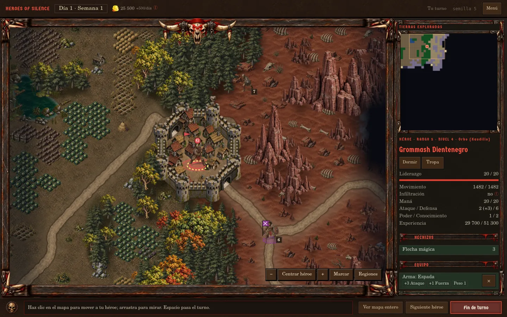
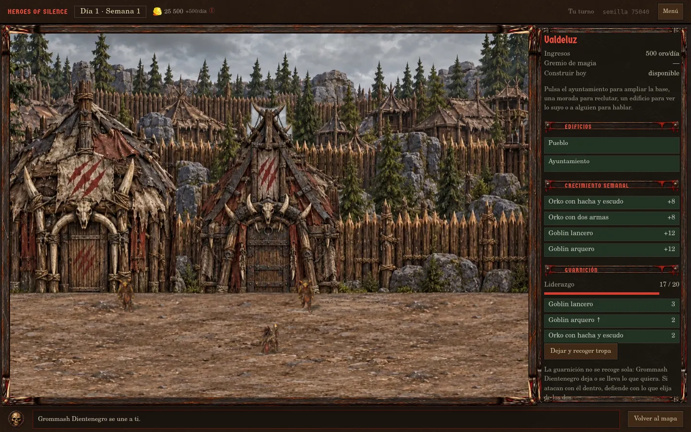
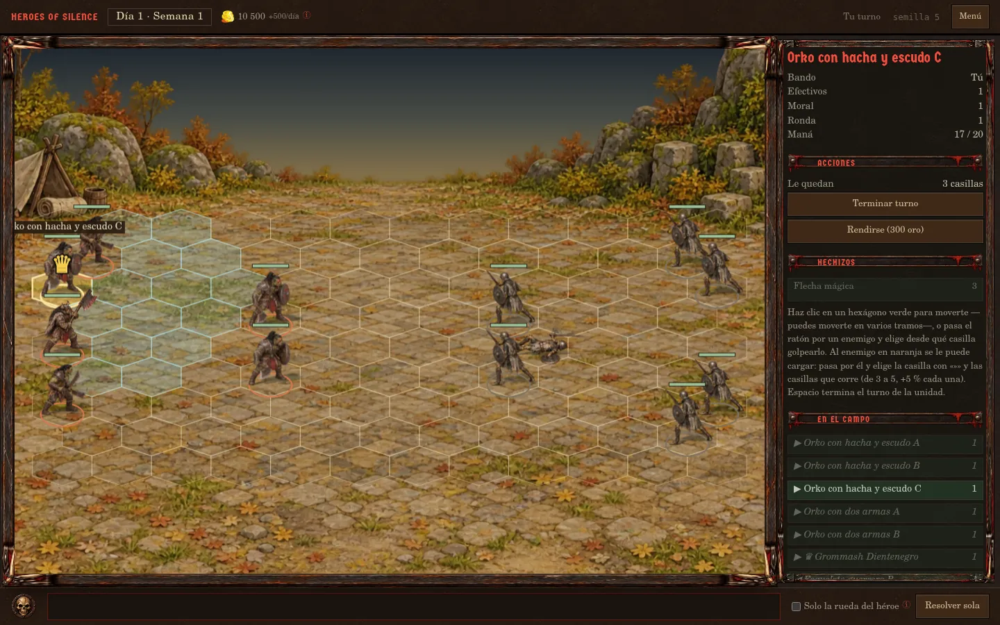

# Heroes of Silence

Un juego de estrategia por turnos en el navegador, al estilo de *Heroes of Might
and Magic 2*, construido como banco de pruebas para tres ideas:

- los **NPCs los lleva un agente** conectado por MCP, no un árbol de decisión;
- los **mapas los diseña ese mismo agente**, que devuelve un plan declarativo en
  vez de dibujar nada, y un motor de narrativa escribe sus **mundos**: lugares,
  gente y una trama que los cruza;
- **todo el arte está generado con IA** — terrenos, ciudades, criaturas y sus
  animaciones en ocho direcciones.

El juego es el andamio. Lo interesante es lo que se puede enchufar dentro.



## Qué hay hecho

**Una partida entera contra la IA de reglas.** Un menú de inicio para elegir una
de las cinco facciones —templarios, no muertos, imperio, elfos y orkos—, cada una
con su tema de interfaz. El mapa es una red de regiones cerradas por montañas,
bosques, acantilados, ríos y murallas, con pasos de una casilla entre ellas que se
toman y se fortifican; las ciudades son recintos amurallados en mitad de su región
y se entra por sus puertas. Lo explorado se descubre por regiones enteras y el
clima (niebla, lluvia, tormenta, noche) cambia por región. **Solo hay oro**: sale
de las ciudades, los pueblos y los cofres. Una partida termina con un ganador.

**La base se recorre andando.** Es un escenario lateral por el que camina el héroe:
se pulsa un edificio para levantarlo o mejorarlo, una morada abre su versión
abierta con una figura por unidad que recluta, y ante el ayuntamiento se elige y
se paga el héroe de salida.



**La batalla es de individuos.** Un tablero de 104 casillas (filas de 12 y de 11),
una unidad por casilla y el héroe en el campo con su tropa. Primero se despliega,
el defensor sin ver al enemigo. Al golpear cuerpo a cuerpo, quien pega y quien
recibe eligen a ciegas en **la rueda del golpe** —ofensivo, fuerte, finta,
defensivo, rápido, romper guardia—, y el cruce decide la tirada; la carga premia
la carrera en recta, salir del contacto cuesta, la armadura para cada golpe, los
tiradores apuntan a una casilla y disparan al turno siguiente, y las granadas
explotan después. Sin suerte: la única tirada es la de la rueda. Las ciudades y
los pueblos se defienden tras su muralla, con puertas y escaleras.



**Fuerza, agilidad y equipo.** Cada unidad es un cuerpo con su equipo (arma, segunda
arma, arma a distancia, armadura, escudo y montura); de las dos cosas salen sus
cifras y su nivel, que nadie escribe a mano. La tropa gana experiencia y rangos, y
con el agente un veterano puede hacerse héroe.

**La arena edita el catálogo.** `pnpm arena` abre el editor de unidades, piezas de
equipo y hechizos del juego, con su ficha y su nivel al momento, y monta peleas
con las mismas reglas, también tras una muralla; una pelea se comparte con un
enlace.

**Un agente puede jugar.** Se conecta por MCP y recibe el turno con el estado y
el formato de respuesta en el mismo mensaje; elige también su golpe en la rueda y
puede pedir el clima de la narración. Si no hay agente conectado, juega una IA de
reglas y la partida sigue igual.

**Y se le puede ver jugar.** `pnpm mirar` abre una página de solo lectura que
enseña la partida del servidor: el mapa, las banderas, el día, la crónica, el
parte de guerra y —esto es lo que importa— **las batallas mientras se deciden**,
con la rueda de cada golpe. El servidor emite un fotograma por cada acción
aplicada; también sale lo que va pensando el agente, el `reasoning` que manda con
cada turno, escapado como todo lo demás.

**Los mundos.** En `pnpm dev`, tras elegir la facción, «Generar el mundo» lanza a
Claude Code sin pantalla con la skill `motor-de-mundos`: escribe la biblia de la
trama y después la historia jugable —lugares con gente y diálogos en árbol,
encuentros y dos desenlaces que se excluyen— sobre un mapa ya congelado.

**El arte se genera.** Lo pinta el taller (`pnpm taller`) con ChatGPT por la
suscripción de Codex, sobre el maniquí del Y Bot: cada figura en ocho
direcciones, con sus hojas de animación; los edificios de la base, el escenario
del mapa por piezas y la gente de los mundos, también. Sin una imagen, cada
pantalla pinta su marcador y el juego sigue.

## Arrancar

```bash
pnpm install
pnpm dev      # http://localhost:3100 — el menú de inicio y la partida contra la IA de reglas
pnpm arena    # http://localhost:3100/arena/ — el catálogo y las peleas
pnpm test
```

Para que juegue un agente hacen falta dos terminales:

```bash
pnpm partida                      # terminal 1: la partida
# terminal 2: Claude Code en esta carpeta. El MCP "heroes" ya está en .mcp.json.
#   «juega la partida: llama a heroes_listen, decide, responde con
#    heroes_respond, y repite»
```

Y una tercera terminal para **mirar** esa partida mientras se juega:

```bash
pnpm mirar                        # abre http://localhost:3100/espectador/
```

El espectador es de **solo lectura**: no manda ni una acción, solo escucha el
canal del servidor y pinta. Se conecta a `ws://localhost:9880`, que es lo que
mueve `HEROES_SPECTATOR_PORT`; si el servidor arrancó con `0` —para que el puerto
lo elija el sistema— la página lo dice y te manda a
`/espectador/?puerto=NNNN`, con el número que imprime `pnpm partida`.

Y para comprobar el circuito entero sin tocar nada a mano:

```bash
pnpm qa
```

## Cómo está montado

```
src/core/      las reglas. TypeScript puro: sin DOM y sin node:*
               battle/ map/ state/ unidad/ equipo/ hero/ town/ ai/ magia/ mundo/
               contract/ (lo que habla con el agente)
src/server/    bridge WebSocket + puente MCP para el agente
src/client/    Vite + Canvas 2D; solo pinta y manda intents por sesion/
               partida/ (el juego), batalla/, render/, arena/, espectador/
src/shared/    lo que comparten el cliente y el taller (la cámara, la base)
tools/taller/  el taller que pinta el arte con Codex (`pnpm taller`)
tools/qa/      las comprobaciones: el agente, las capturas, el banco y las medidas
data/          unidades, equipo, edificios, economía, hechizos… en JSON editable
assets/        el arte generado y los mundos
docs/areas/    el detalle de cada parte, con el porqué de cada regla
```

La frontera que no se cruza: **la lógica vive en `core` y el cliente solo
pinta**. Y toda tirada de dados pasa por un generador con semilla, así que una
partida es reproducible y los tests no son una lotería.

Más detalle en [`CLAUDE.md`](CLAUDE.md), el índice, y en `docs/areas/`.

## Sobre el original

Los datos del *Heroes of Might and Magic 2* original son propiedad de Ubisoft y
**no se usan aquí**: ni un sprite, ni un sonido, ni un `.AGG`. Lo que se
reimplementa son las reglas —que no son objeto de copyright, y por eso existen
fheroes2 y VCMI— y todo el arte está generado. De ahí también el nombre. Las
cifras que vienen de [fheroes2](https://github.com/ihhub/fheroes2) se copian de su
código, no de la memoria; lo que es regla nuestra lo dice `CLAUDE.md`.

## Licencia

MIT.
